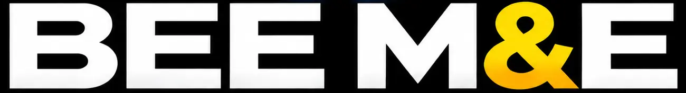
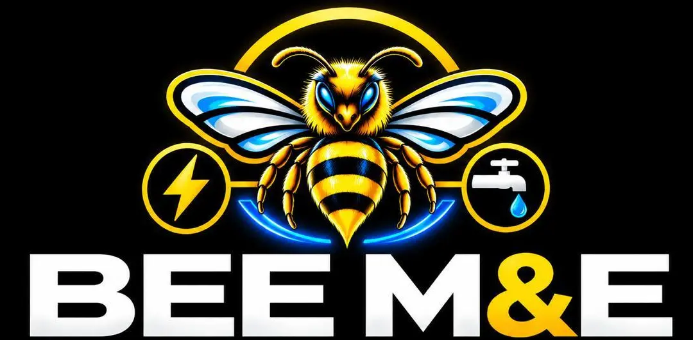

# Bee M&E brand assets

These are direct crops of the supplied artwork, retaining its lettering, illustration and black background.
They are optimised WebP images; no artwork has been regenerated. The original `public/images/bee-logo.png` is unchanged.

| Asset | Dimensions | Site use |
|---|---|---|
| `public/images/brand/bee-wordmark.webp` | 1024 × 140 | Homepage header while the hero is visible |
| `public/images/brand/bee-emblem.webp` | 680 × 392 | Decorative inner-page illustration |
| `public/images/brand/bee-stacked.webp` | 1080 × 532 | Homepage hero, compact header, other headers, footer and social metadata |

## Previews

### Wordmark



### Emblem


### Stacked logo



## Recreate the assets

From the repository root, with ImageMagick installed:

```bash
mkdir -p public/images/brand
convert public/images/bee-logo.png -crop 680x392+300+0 +repage -quality 90 public/images/brand/bee-emblem.webp
convert public/images/bee-logo.png -crop 1024x140+128+392 +repage -quality 95 public/images/brand/bee-wordmark.webp
convert public/images/bee-logo.png -crop 1080x532+100+0 +repage -quality 90 public/images/brand/bee-stacked.webp
```

The full original composition is no longer referenced by page templates or copied into fresh builds.
The homepage hero uses the stacked bee-and-name artwork without the descriptor or service list. As the artwork
passes behind the sticky header, scroll progress crossfades the wordmark into the compact stacked logo. The fade
finishes before the artwork fully disappears. Scrolling back reverses this; reduced-motion settings use a discrete switch. The four service cards remain the main introduction to the disciplines, supported by the Services dropdown.

Rebuild the website using `npm run build`, then use `npm run preview` to view it locally.
