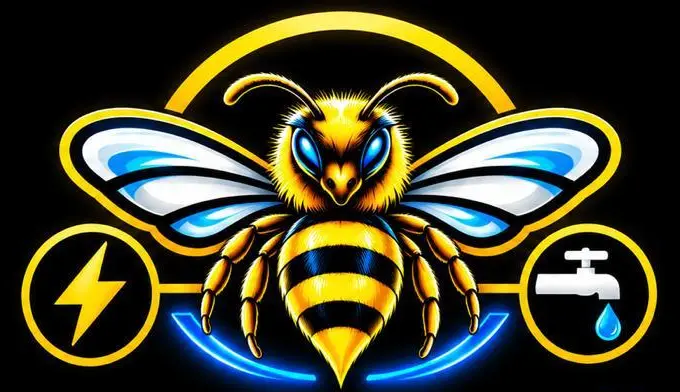

# Bee M&E brand assets

These are direct crops of the supplied artwork, retaining its lettering, illustration and black background.
They are optimised WebP images; no artwork has been regenerated. The current source is `public/images/bee-logo-new.png`; both source images are preserved.

| Asset | Dimensions | Site use |
|---|---|---|
| `public/images/brand/bee-wordmark.webp` | 1300 × 178 | Available for standalone wordmark use |
| `public/images/brand/bee-emblem.webp` | 780 × 496 | Decorative inner-page illustration |
| `public/images/brand/bee-stacked.webp` | 1380 × 674 | Homepage hero, compact header, other headers, footer and social metadata |

## Previews

### Wordmark


### Emblem



### Stacked logo


## Recreate the assets

From the repository root, with ImageMagick installed:

```bash
mkdir -p public/images/brand
convert public/images/bee-logo-new.png -crop 780x496+420+0 +repage -quality 90 public/images/brand/bee-emblem.webp
convert public/images/bee-logo-new.png -crop 1300x178+170+496 +repage -quality 95 public/images/brand/bee-wordmark.webp
convert public/images/bee-logo-new.png -crop 1380x674+120+0 +repage -quality 90 public/images/brand/bee-stacked.webp
```

The full original composition is no longer referenced by page templates or copied into fresh builds.
The homepage hero uses the stacked bee-and-name artwork without the descriptor or service list. The sticky header
always displays the same compact stacked logo. There is no scroll-triggered logo change or animation.

Rebuild the website using `npm run build`, then use `npm run preview` to view it locally.
